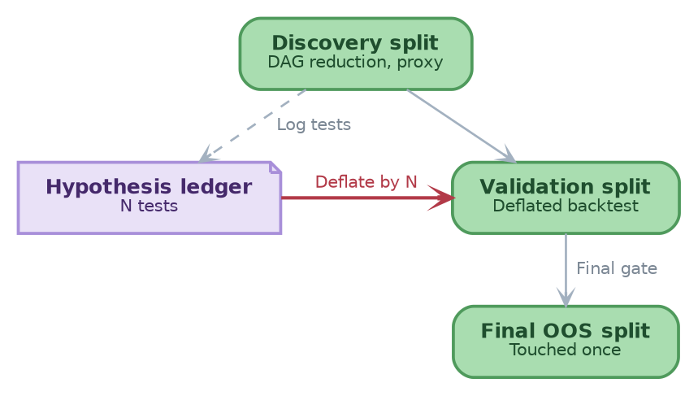

// type=UMD_slides
// course_title=Causal Analysis for Finance
// lesson_title=The Theory Store: From Finance Papers to Testable Hypotheses
// slides_engine=typst

* Roadmap

- This lesson covers the **Theory Store**, a pipeline that reads finance papers
  and outputs causal models, code, and tests
  - Why the literature needs it, and what it does not try to do
  - How the pipeline goes from a paper to verified code, with human gates
  - How provenance and a hypothesis ledger keep claims auditable and backtests
    honest

# The Theory Store

* Why a Theory Store
// From: papers/Causal_Analysis_for_Finance/notes.md:1 '# Goal'
// From: papers/Causal_Analysis_for_Finance/notes.md:42 '## Applications'
// From: papers/Causal_Analysis_for_Finance/notes.md:335 '## Causality in Finance'

- @Problem@: factor papers make _associational_ claims, with no causal graph
  and no falsification test (Lopez de Prado, 2023)
  - Replication studies check the numbers, not the causal specification

- @Goal@: the **Theory Store** turns a corpus of quantitative finance papers
  into _testable_ and _auditable_ hypotheses
  - Every claim traces to a page span in a paper
  - Every test is counted in a ledger, so backtests are deflated honestly

- @Key idea@: automate the repetitive stages and keep humans at the gates
  - Speed up $S \le 1 / (1 - p)$ for automated fraction $p$ (e.g., $S \le 5$
    at $p = 0.8$)

- @Applications@: meta-analysis, replication, gap finding, priors for ML

- @Non-goals@: strategy generation and causal discovery from data alone
  - A backtest only _falsifies_ a theory: it never searches for a strategy
  - Agreement between papers is not causal truth (publication bias exists)

* Pipeline: From Paper to Verified Code
// From: papers/Causal_Analysis_for_Finance/notes.md:57 '# Workflow'
// From: papers/Causal_Analysis_for_Finance/notes.md:231 '## Theory Spec'
// From: papers/Causal_Analysis_for_Finance/notes.md:203 '## Verify Against Source Paper'

```graphviz[width=90%]
digraph TheoryStorePipeline {
  // automated stage : blue | stage ending in a human gate : rose
  bgcolor="transparent";
  pad="0.15";
  splines=spline;
  nodesep=0.30;
  ranksep=0.30;
  rankdir=TB;
  newrank=true;
  compound=true;

  node [shape=box,
        style="rounded,filled",
        fillcolor="#FFFFFF",
        color="#9AA9B8",
        penwidth=1.8,
        fontname="Helvetica",
        fontcolor="#243B53",
        fontsize=14,
        margin="0.18,0.12",
        height=0.50,
        width=2.0];

  edge [color="#A3B1C0",
        penwidth=1.3,
        arrowhead=vee,
        arrowsize=0.75,
        fontname="Helvetica",
        fontsize=10,
        fontcolor="#7B8794"];

  subgraph cluster_bank {
    label     = "Paper bank";
    labelloc  = "t";
    fontname  = "Helvetica-Bold";
    fontsize  = 12.5;
    fontcolor = "#3A4A5C";
    style     = "rounded,filled";
    fillcolor = "#F7F9FB";
    color     = "#C7D0DA";
    penwidth  = 1.0;
    margin    = 16;

    Parse   [label=<<b>Parse papers</b><br/><font point-size="10" color="#A34F6C">LaTeX, Markdown, PDF</font>>,
             fillcolor="#F6E1E8", color="#D98CA8", fontcolor="#6B2A44"];
    Extract [label=<<b>Extract claims</b><br/><font point-size="10" color="#41719C">Stated or inferred</font>>,
             fillcolor="#D3E3F3", color="#7CA6CE", fontcolor="#1F4E79"];
    Parse -> Extract;
  }

  subgraph cluster_spec {
    label     = "Theory Spec";
    labelloc  = "t";
    fontname  = "Helvetica-Bold";
    fontsize  = 12.5;
    fontcolor = "#3A4A5C";
    style     = "rounded,filled";
    fillcolor = "#F7F9FB";
    color     = "#C7D0DA";
    penwidth  = 1.0;
    margin    = 16;

    Normalize [label=<<b>Normalize variables</b><br/><font point-size="10" color="#A34F6C">Canonical ids</font>>,
               fillcolor="#F6E1E8", color="#D98CA8", fontcolor="#6B2A44"];
    MakeDag   [label=<<b>Create DAG</b><br/><font point-size="10" color="#A34F6C">Lags, regime edges</font>>,
               fillcolor="#F6E1E8", color="#D98CA8", fontcolor="#6B2A44"];
    MapData   [label=<<b>Map nodes to data</b><br/><font point-size="10" color="#41719C">Point-in-time series</font>>,
               fillcolor="#D3E3F3", color="#7CA6CE", fontcolor="#1F4E79"];
    Normalize -> MakeDag -> MapData;
  }

  subgraph cluster_valid {
    label     = "Causal validation";
    labelloc  = "t";
    fontname  = "Helvetica-Bold";
    fontsize  = 12.5;
    fontcolor = "#3A4A5C";
    style     = "rounded,filled";
    fillcolor = "#F7F9FB";
    color     = "#C7D0DA";
    penwidth  = 1.0;
    margin    = 16;

    Merge  [label=<<b>Merge DAGs</b><br/><font point-size="10" color="#41719C">Literature graph</font>>,
            fillcolor="#D3E3F3", color="#7CA6CE", fontcolor="#1F4E79"];
    Reduce [label=<<b>Reduce DAG</b><br/><font point-size="10" color="#A34F6C">Identification, CI tests</font>>,
            fillcolor="#F6E1E8", color="#D98CA8", fontcolor="#6B2A44"];
    Prior  [label=<<b>Formalize hypotheses</b><br/><font point-size="10" color="#41719C">Bayesian prior</font>>,
            fillcolor="#D3E3F3", color="#7CA6CE", fontcolor="#1F4E79"];
    Merge -> Reduce -> Prior;
  }

  subgraph cluster_code {
    label     = "Code and test";
    labelloc  = "t";
    fontname  = "Helvetica-Bold";
    fontsize  = 12.5;
    fontcolor = "#3A4A5C";
    style     = "rounded,filled";
    fillcolor = "#F7F9FB";
    color     = "#C7D0DA";
    penwidth  = 1.0;
    margin    = 16;

    Code     [label=<<b>Generate code</b><br/><font point-size="10" color="#41719C">Simulator, replication</font>>,
              fillcolor="#D3E3F3", color="#7CA6CE", fontcolor="#1F4E79"];
    Verify   [label=<<b>Verify vs paper</b><br/><font point-size="10" color="#41719C">Match its tables</font>>,
              fillcolor="#D3E3F3", color="#7CA6CE", fontcolor="#1F4E79"];
    Validate [label=<<b>Validation</b><br/><font point-size="10" color="#A34F6C">Backtest, final OOS</font>>,
              fillcolor="#F6E1E8", color="#D98CA8", fontcolor="#6B2A44"];
    Code -> Verify -> Validate;
  }

  // Columns flow left to right, stages flow top to bottom inside a column
  { rank=same; Parse; Normalize; Merge; Code; }
  { rank=same; Extract; MakeDag; Reduce; Verify; }
  { rank=same; MapData; Prior; Validate; }

  // Arrows between columns go cluster to cluster along the top row
  Parse -> Normalize [ltail=cluster_bank, lhead=cluster_spec, penwidth=1.8];
  Normalize -> Merge [ltail=cluster_spec, lhead=cluster_valid, penwidth=1.8];
  Merge -> Code [ltail=cluster_valid, lhead=cluster_code, penwidth=1.8];
}
```

label=fig:theory-store-pipeline
caption=The Theory Store pipeline: rose stages end in a human gate, blue stages are automated.

- @Definition@: every stage reads and writes one **Theory Spec** per paper,
  with `nodes`, `edges`, `assumptions`, `estimand`, and `empirical_spec`
  - The DAG is one view of it: a bare DAG lacks data recipes, estimators, and
    timing

- @Remark@: verification routes each mismatch back to the stage that caused it
  - E.g., wrong data recipe $\to$ claims, missing confounder $\to$ Theory Spec,
    bug $\to$ code

* Auditable Claims, Honest Tests
// From: papers/Causal_Analysis_for_Finance/notes.md:90 '## Extract Causal Claims'
// From: papers/Causal_Analysis_for_Finance/notes.md:258 '## Hypothesis Ledger and Data Splits'

::: columns
:::: {.column width=60%}
- @Problem@: two ways to fool yourself
  1. An LLM invents an edge: LLMs perform near random when they infer causation
     from correlation (Jin et al., 2023)
  2. Double dipping: DAG reduction tests edges, then the backtest reuses the
     same data

- @Solution 1@: a provenance pointer on every claim
  - E.g., PDF page span, LaTeX file and line
  - No stage depends silently on an `inferred` claim

- @Solution 2@: a hypothesis ledger and three data splits
  - The ledger logs every edge test, proposed edge, proxy choice, and prior fit
  - Deflate the backtest statistics by the size $N$ of the ledger
  - E.g., a new factor needs $t \ge 3.0$ (Harvey et al., 2016)
::::
:::: {.column width=40%}

label=fig:ledger-splits
caption=Green data splits are used in order, and the violet ledger counts every test to deflate the backtest.

::::
:::

* Summary

- @Key idea@: the Theory Store turns finance papers into typed Theory Specs,
  code, and tests, and a human approves each gate
- A provenance pointer on every claim makes each causal edge auditable
- A ledger of every test deflates the backtest, which only falsifies theories

* References

- **Jin et al.**: _"Can Large Language Models Infer Causation From
  Correlation?"_, arXiv (2023)

- **Lopez de Prado**: _"Causal Factor Investing: Can Factor Investing Become
  Scientific?"_, SSRN (2023)

- **Harvey et al.**: _"...and the Cross-Section of Expected Returns"_,
  SSRN (2016)
