// type=ADIA_slides
// course_title=Abu Dhabi Investment Authority
// lesson_title=The Theory Store: From Finance Papers to Testable Hypotheses
// Authors=GP, Rui, Emanuele (FA), ...
// slides_engine=typst

// TODO(ai_gp): Replace the color in parenthesis with the color
// Two sources of a factor mirage: an omitted confounder Z (purple) and a controlled collider C (red) both create an association between X and Y.
// Two sources of a factor mirage: an omitted confounder \purple{Z} and a controlled collider \red{C} both create an association between X and Y.

* Summary

- @What@ the Theory Store is (and what is not)

- @Why@: What are the advantages (and its limitations) of the Theory Store?

- @How@ to build the Theory Store?
  - From papers to claims
  - Building the causal graph
  - Validating the graph
  - From graph to verified code
  - Model evaluation

- @When@ can the Theory Store be available?
  - Build incrementally to deliver value quickly

- @Related work@

// TODO(ai_gp): Create headers following the summary slide like
// # What the Theory Store?
// # Why the Theory Store
// # How to build the Theory Store?
// ## From papers to claims
// ## ...
// # When can the Theory Store be available?
// # Related work

# The Theory Store

* The Theory Store: Motivation
// From: papers/Causal_Analysis_for_Finance/notes.md:1 '# Goal'
// From: papers/Causal_Analysis_for_Finance/notes.md:335 '## Causality in Finance'

- @Problem@: most papers make _associational_ claims
  - They state no causal graph and run no falsification test (Lopez de Prado, 2023)
  - Replication studies check the numbers, but none tests the causal specification
    (Hou et al., 2020; Jensen et al., 2023)

- @Problem@: hundreds of alpha / factors were tested on the same data
  - Multiple testing leads to high rate of false discovery (Harvey et al., 2016)
  - Reproducibility crisis

- @Intuition@: a **paper** should be a causal theory plus one empirical test
  - Formalize the theory, and the test can be reproduced, challenged, falsified

- @Question@: can a machine read the literature and return theories that humans
  can test, understand, and falsify?

* The Theory Store: Goals
// From: papers/Causal_Analysis_for_Finance/notes.md:1 '# Goal'
// From: papers/Causal_Analysis_for_Finance/notes.md:10 '- Target: automate 80-90% of the effort'

- @Goal@:
  - Turn a corpus of finance and economics papers into **testable** and **auditable**
    hypotheses
  - Count number of hypothesis to properly account for data mining and overfitting
  - Automate the repetitive stages, keep humans at the gates
    - _Tool_: parse, extract, normalize, map to data, bookkeeping
    - _Human_: choose papers, approve names and DAGs, pass the final gate
  - Build a comprehensive understanding of economic / financial systems that can
    be queried, reasoned about (by humans and machines), actioned, ...

::: columns
:::: {.column width=60%}

- @Benefits@: the target is to automate 80-90% of the repeatitive effort
  - Human gates bound the speed up $S$, as in Amdahl's law

::::
:::: {.column width=40%}

$$
S \triangleq \frac{T_{manual}}{T_{tool}} \le \frac{1}{1 - p}
$$

```{=typst}
#styled-table(
  headers: ("Automated fraction p", "Max speed up S"),
  rows: (
    ("50%", "2x"),
    ("80%", "5x"),
    ("90%", "10x"),
    ("95%", "20x"),
  ),
  bold-first-col: false,
  width: 100%,
)
```

::::
:::

* Constraints

- The Theory Store:

  - Must @be modular@
    - Generate and validate causal hypotheses
    - Let users falsify / evaluate performance of theory with their own flow

  - Must @follow and enforce@ all the rules of our research process
    - Split the data before any test
    - Generate hypotheses, then try to falsify them
    - Use economic reasoning (and not black-box or gray-box machine learning)
    - Deflate the Sharpe ratio
    - Use an embargo between data splits
    - ...

* Non-Goals
// From: papers/Causal_Analysis_for_Finance/notes.md:31 '- Non-goals'

- @Key idea@: the Theory Store tests theories, it does not mine for them

```{=typst}
#styled-table(
  headers: ("The Theory Store does", "The Theory Store does not"),
  rows: (
    ("Use backtests to falsify theories", "Use backtests to find trading strategies"),
    ("Test the causal structure stated in papers", "Discover causality from data alone"),
    ("Weigh the evidence across papers", "Treat agreement between papers as causal truth"),
    ("Check that the estimand is identifiable", "Read an identified DAG as proof of causality"),
    ("Augment the intuition of the researcher", "Replace the intuition of the researcher"),
  ),
  bold-first-col: false,
  width: 95%,
)
```

- @Remark@: agreement between papers is weak evidence because publication bias
  exists

* Applications
// From: papers/Causal_Analysis_for_Finance/notes.md:42 '## Applications'

::: columns
:::: {.column width=60%}
- @Applications@:
  1. **Literature meta-analysis**: compare the causal structures of papers to
     find which papers agree or disagree
  2. **Questions over a corpus**: e.g., _"What drives inflation
     expectations?"_
  3. **Gap finding**: list the variable pairs that no paper tests, a map of
     open questions
  4. **Replication**: build the financial models that papers and books
     describe
  5. **Economic prior for ML**: use the reduced DAG to pick features, set
     lags, and regularize
::::
:::: {.column width=40%}

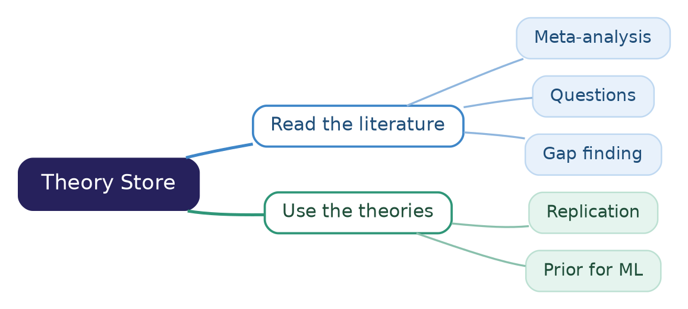
label=fig:applications
caption=The applications split into reading the literature (blue) and using the extracted theories (teal).

::::
:::

- @Intuition@: a model that follows a causal story overfits less
  - It searches a smaller space of models, fixed before it sees the data

* Pipeline Overview
// From: papers/Causal_Analysis_for_Finance/notes.md:57 '# Workflow'
// From: papers/Causal_Analysis_for_Finance/notes.md:277 '## Human Review Gates and Metrics'

```graphviz[width=90%]
digraph TheoryStorePipeline {
  // automated stage : blue | stage ending in a human gate : rose
  bgcolor="transparent";
  pad="0.15";
  splines=spline;
  nodesep=0.30;
  ranksep=0.30;
  rankdir=TB;
  newrank=true;
  compound=true;

  node [shape=box,
        style="rounded,filled",
        fillcolor="#FFFFFF",
        color="#9AA9B8",
        penwidth=1.8,
        fontname="Helvetica",
        fontcolor="#243B53",
        fontsize=14,
        margin="0.18,0.10",
        height=0.48,
        width=2.0];

  edge [color="#A3B1C0",
        penwidth=1.3,
        arrowhead=vee,
        arrowsize=0.75,
        fontname="Helvetica",
        fontsize=10,
        fontcolor="#7B8794"];

  subgraph cluster_claims {
    label     = "Papers to claims";
    labelloc  = "t";
    fontname  = "Helvetica-Bold";
    fontsize  = 12.5;
    fontcolor = "#3A4A5C";
    style     = "rounded,filled";
    fillcolor = "#F7F9FB";
    color     = "#C7D0DA";
    penwidth  = 1.0;
    margin    = 16;

    Bank    [label=<<b>Build paper bank</b><br/><font point-size="10" color="#A34F6C">Parse, filter</font>>,
             fillcolor="#F6E1E8", color="#D98CA8", fontcolor="#6B2A44"];
    Extract [label=<<b>Extract claims</b><br/><font point-size="10" color="#41719C">Stated or inferred</font>>,
             fillcolor="#D3E3F3", color="#7CA6CE", fontcolor="#1F4E79"];
    Bank -> Extract;
  }

  subgraph cluster_graph {
    label     = "Causal graph";
    labelloc  = "t";
    fontname  = "Helvetica-Bold";
    fontsize  = 12.5;
    fontcolor = "#3A4A5C";
    style     = "rounded,filled";
    fillcolor = "#F7F9FB";
    color     = "#C7D0DA";
    penwidth  = 1.0;
    margin    = 16;

    Normalize [label=<<b>Normalize variables</b><br/><font point-size="10" color="#A34F6C">Canonical ids</font>>,
               fillcolor="#F6E1E8", color="#D98CA8", fontcolor="#6B2A44"];
    MakeDag   [label=<<b>Create DAG</b><br/><font point-size="10" color="#A34F6C">Lags, regime edges</font>>,
               fillcolor="#F6E1E8", color="#D98CA8", fontcolor="#6B2A44"];
    MapData   [label=<<b>Map nodes to data</b><br/><font point-size="10" color="#41719C">Point-in-time series</font>>,
               fillcolor="#D3E3F3", color="#7CA6CE", fontcolor="#1F4E79"];
    Merge     [label=<<b>Merge DAGs</b><br/><font point-size="10" color="#41719C">Literature graph</font>>,
               fillcolor="#D3E3F3", color="#7CA6CE", fontcolor="#1F4E79"];
    Normalize -> MakeDag -> MapData -> Merge;
  }

  subgraph cluster_valid {
    label     = "Validation";
    labelloc  = "t";
    fontname  = "Helvetica-Bold";
    fontsize  = 12.5;
    fontcolor = "#3A4A5C";
    style     = "rounded,filled";
    fillcolor = "#F7F9FB";
    color     = "#C7D0DA";
    penwidth  = 1.0;
    margin    = 16;

    Reduce [label=<<b>Reduce DAG</b><br/><font point-size="10" color="#A34F6C">Identification, CI tests</font>>,
            fillcolor="#F6E1E8", color="#D98CA8", fontcolor="#6B2A44"];
    Proxy  [label=<<b>Optimize vs proxy</b><br/><font point-size="10" color="#41719C">E.g., supply, demand</font>>,
            fillcolor="#D3E3F3", color="#7CA6CE", fontcolor="#1F4E79"];
    Prior  [label=<<b>Formalize hypotheses</b><br/><font point-size="10" color="#41719C">Bayesian prior</font>>,
            fillcolor="#D3E3F3", color="#7CA6CE", fontcolor="#1F4E79"];
    Reduce -> Proxy -> Prior;
  }

  subgraph cluster_code {
    label     = "Verified code";
    labelloc  = "t";
    fontname  = "Helvetica-Bold";
    fontsize  = 12.5;
    fontcolor = "#3A4A5C";
    style     = "rounded,filled";
    fillcolor = "#F7F9FB";
    color     = "#C7D0DA";
    penwidth  = 1.0;
    margin    = 16;

    Code     [label=<<b>Generate code</b><br/><font point-size="10" color="#41719C">Simulator, replication</font>>,
              fillcolor="#D3E3F3", color="#7CA6CE", fontcolor="#1F4E79"];
    Verify   [label=<<b>Verify vs paper</b><br/><font point-size="10" color="#41719C">Match its tables</font>>,
              fillcolor="#D3E3F3", color="#7CA6CE", fontcolor="#1F4E79"];
    Validate [label=<<b>Validation</b><br/><font point-size="10" color="#A34F6C">Backtest, final OOS</font>>,
              fillcolor="#F6E1E8", color="#D98CA8", fontcolor="#6B2A44"];
    Code -> Verify -> Validate;
  }

  // Columns flow left to right, stages flow top to bottom inside a column
  { rank=same; Bank; Normalize; Reduce; Code; }
  { rank=same; Extract; MakeDag; Proxy; Verify; }
  { rank=same; MapData; Prior; Validate; }

  // Arrows between columns go cluster to cluster along the top row
  Bank -> Normalize [ltail=cluster_claims, lhead=cluster_graph, penwidth=1.8];
  Normalize -> Reduce [ltail=cluster_graph, lhead=cluster_valid, penwidth=1.8];
  Reduce -> Code [ltail=cluster_valid, lhead=cluster_code, penwidth=1.8];
}
```
label=fig:theory-store-pipeline
caption=The Theory Store pipeline: rose stages end in a human gate, blue stages are automated.

- @Key idea@: every stage reads and writes one typed **Theory Spec** per paper
  - A human gate follows the paper list, normalization, DAG, reduction, and
    comes before the proposal

# From Papers to Claims

* The Theory Spec
// From: papers/Causal_Analysis_for_Finance/notes.md:231 '## Theory Spec'

::: columns
:::: {.column width=62%}
- @Definition@: a **Theory Spec**
  - Represents a causal theory
  - Is one typed object that every pipeline stage reads and writes
  - A bare DAG lacks "data recipes", estimators, and timing, so it is not enough to
    generate code

- @Components@:
  - `nodes`: name, observed or latent, data recipe, unit, time index, level
  - `edges`: sign, lag, functional form, confidence, provenance, status
  - `assumptions`: e.g., no unobserved confounding
  - `estimand`: e.g., ATE of a characteristic on next-month return
  - `empirical_spec`: regressions, sorts, controls, fixed effects, sample
::::
:::: {.column width=38%}

// TODO(gp): Check the example Theory Spec: self-made illustration, the data recipe is simplified
```{=typst}
#set text(size: 0.75em)
```

```yaml
nodes:
  - id: book_to_market
    recipe: ceq / me
    level: firm
  - id: ret_next_month
edges:
  - source: book_to_market
    target: ret_next_month
    sign: "+"
    lag: 1 month
    provenance: p. 12
    status: stated
assumptions:
  - no_unobserved_confounding
estimand: ATE
empirical_spec: decile_sort
```

(For illustration purpose only!)

::::
:::

* Build the Paper Bank
// From: papers/Causal_Analysis_for_Finance/notes.md:59 '## Build Paper Bank'

::: columns
:::: {.column width=65%}

- @Goal@: collect the papers, books, and reports that the pipeline reads
  - A human guides the search and approves the final list

- @Algorithm@: Candidate papers (orange) pass automated filters (blue) and a human
  gate (rose) before entering the paper bank (green)

::::
:::: {.column width=35%}

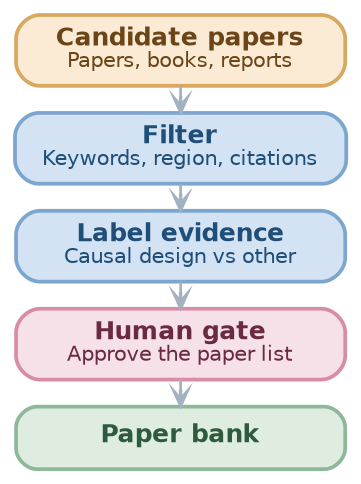
label=fig:paper-bank

::::
:::

- @Techniques@: filter the candidates by:
  - Keywords (e.g., microeconomic, macroeconomic)
  - Region (e.g., APAC, EMEA, US)
  - Citations (citations lag and favor known authors)
  - Quality of the researchers and institution
  - Label each paper by its evidence: causal design, association, ...

* Parse Into One Representation
// From: papers/Causal_Analysis_for_Finance/notes.md:59 '## Build Paper Bank'
// From: papers/Causal_Analysis_for_Finance/notes.md:308 '- Input format ablation'

- @Problem@: papers come as LaTeX, Markdown, or PDF

- @Solution@: one front end per format, all writing one **normalized document**
  - Sections, equations, tables, bibliography, and source anchors
  - Later stages read only this representation, so they are format agnostic

// TODO(ai_gp): Split "Front end" and "Tool"
```{=typst}
#styled-table(
  headers: ("Format", "Front end", "Fidelity"),
  rows: (
    ("LaTeX", "Parse the source", "Exact equations and tables"),
    ("Markdown", "Parse the AST (e.g., with pandoc)", "Depends on the converter that made the Markdown"),
    ("PDF", "Layout and OCR extraction (e.g., Nougat, Marker, GROBID)", "Equation and table errors possible"),
  ),
  col-widths: (0.6fr, 2fr, 1.2fr),
  width: 95%,
)
```

- @Remark@: LaTeX > Markdown > PDF
  - Tables become verification targets for the generated code

* Extract Causal Claims
// From: papers/Causal_Analysis_for_Finance/notes.md:90 '## Extract Causal Claims'

::: columns
:::: {.column width=58%}
- @Definition@: a **causal claim** is one record per relationship in a paper
  - `(cause, effect, sign, lag, region, period, design)`
  - Status:
    - `stated` (the paper says it)
    - `inferred` (the LLM deduced it)
  - Context and a reference, for human analysis

- @Definition@: a **provenance pointer** locates the claim in its source
  - A provenance pointer on every item is the main defense against hallucinated edges
  - A human checks a claim in seconds by opening the pointer
::::
:::: {.column width=42%}

// TODO(gp): Check the example claim: self-made illustration of a value-premium claim
```{=typst}
#set text(size: 0.85em)
```

```yaml
cause: book_to_market
effect: ret_next_month
sign: "+"
lag: 1 month
region: US
period: 1963-1990
design: portfolio_sort
status: stated
context: "high book-to-market
  firms earn higher returns"
provenance:
  format: pdf
  page: 12
  span: [431, 618]
```

(For illustration purpose only!)

::::
:::

* Stated vs Inferred Claims
// From: papers/Causal_Analysis_for_Finance/notes.md:90 '## Extract Causal Claims'
// From: papers/Causal_Analysis_for_Finance/notes.md:355 '## Causal Structure From Text'

::: columns
:::: {.column width=60%}
- @Problem@: LLMs are unreliable when they _infer_ causal relations
  - Near random when they infer causation from correlation
    (Jin et al., 2023)
  - They may recite causal knowledge instead of reasoning
    (Zecevic et al., 2023)

// TODO(gp): Check the accruals example: self-made illustration
- @Example@: _"high-accrual firms earn low returns"_ is `stated`, but
  _"accruals cause low returns"_ is `inferred`

- @Solution@:
  - No stage depends _silently_ on an `inferred` claim
  - A human sees every use of one at the next gate
::::
:::: {.column width=40%}

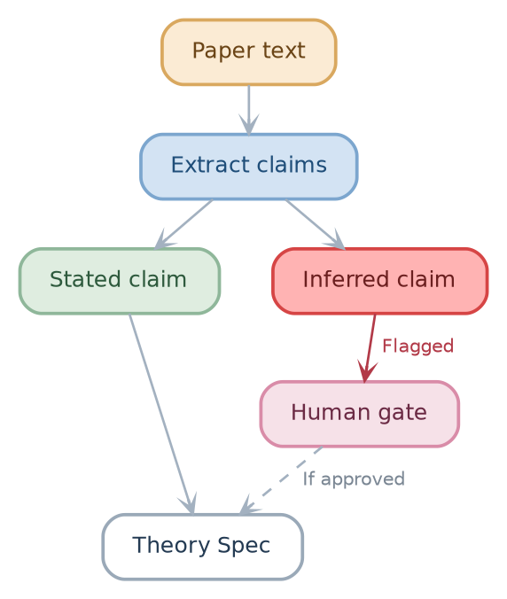
label=fig:stated-inferred
caption=Stated claims (green) enter the Theory Spec directly, while inferred claims (red) pass a human gate (rose) first.

::::
:::

# Building the Causal Graph

* Normalize Variables
// From: papers/Causal_Analysis_for_Finance/notes.md:108 '## Normalize Variables'

::: columns
:::: {.column width=58%}
- @Problem@: papers name the same variable in different ways
  - E.g., _"monetary tightening"_, _"policy rate hike"_, _"increase in the
    federal funds rate"_

- @Solution@: map each variable to a **canonical id** in a small finance
  ontology
  - E.g., `value`, `size`, `momentum`, `accruals`, `leverage`
  - Express changes with **operators** (e.g., `increase`, `delay`)
  - Canonical ids let graphs from different papers merge

- @Techniques@: a specialized LLM, trained on finance literature, proposes the
  mapping, and a human reviews it
  - Human gate: approve the canonical names and operators
::::
:::: {.column width=42%}

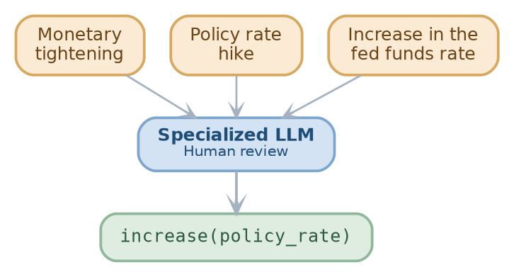
label=fig:normalize
caption=Three phrases from different papers (orange) map to one canonical id with an operator (green).

::::
:::

* Create the DAG
// From: papers/Causal_Analysis_for_Finance/notes.md:119 '## Create DAG'

::: columns
:::: {.column width=58%}
- @Definition@: the **DAG** of a paper has
  - Economic / financial variables as nodes
  - Claimed causal relationships as edges (with operators such as delays, ...)

- @Problem@: theories can contain feedback loops, but a DAG has no cycle
  (open research problem)
- @Solution@:
  - Unroll in time ($X_t \to Y_{t+1}$, $Y_t \to X_{t+1}$)
  - Route equilibrium papers to a structural-equations and solver path, not to a DAG
::::
:::: {.column width=42%}

// TODO(gp): Check the fund flows and returns example: self-made illustration of a feedback loop
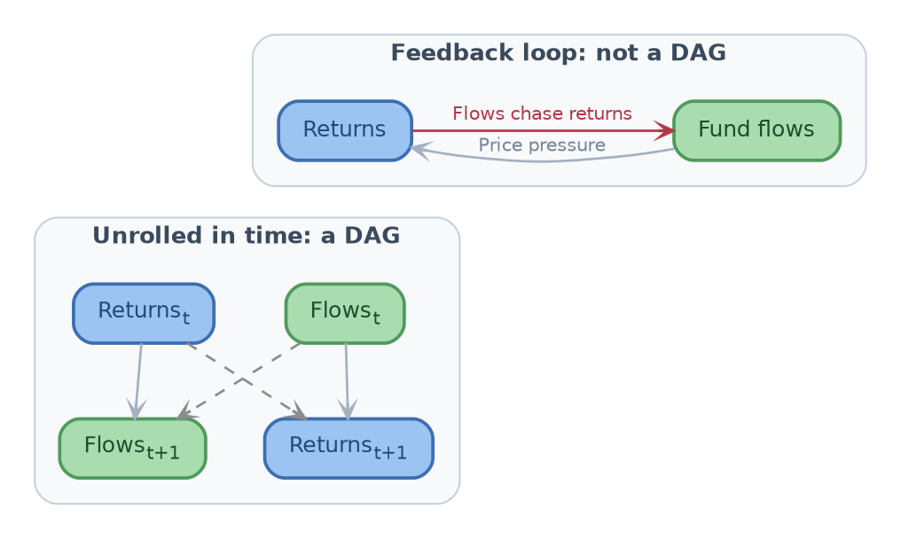
label=fig:unroll
caption=A feedback loop between fund flows (green) and returns (blue) becomes a DAG once each variable is indexed by time.

::::
:::

* Map Nodes to Data
// From: papers/Causal_Analysis_for_Finance/notes.md:138 '## Map Nodes to Data'

- @Goal@: map each node to a time series in a data store (e.g., ADIA Atlas, ...)
  - Assess the quality of each series: coverage, time span, gaps

- Data source to handle the common data problems

  ```{=typst}
  #styled-table(
    headers: ("Source of bias", "Example", "Fix"),
    rows: (
      ("Revisions", "Macro series (e.g., GDP) change after the first release", "Use point-in-time vintages"),
      ("Release timing", "A series comes out weeks after its period ends", "Encode the availability timing of each series"),
      ("Reporting lag", "Annual reports come out months after the fiscal year ends", "Use firm data only after its filing date"),
      ("Fiscal-year alignment", "Firms end their fiscal year in different months", "Align firms on availability, not on period end"),
    ),
    col-widths: (1fr, 2fr, 1.8fr),
    width: 95%,
  )
  ```

* Conflicts Between Papers
// From: papers/Causal_Analysis_for_Finance/notes.md:119 '## Create DAG'

::: columns
:::: {.column width=62%}
- @Problem@: papers disagree on the sign, region, and period of an edge
  - How to merge DAGs?

- @Naive Solution@: keep the majority sign, drop the other claims
  - Cons: loses the conditions under which each effect holds
  - Cons: the majority may reflect publication bias

- @Solution@: turn a sign conflict into a **conditional** or **regime** edge
  - The sign of $X \to Y$ depends on a regime variable (e.g., region,
    period)
  - Keep every claim with its provenance

- @Example@: $X \to Y$ is positive in the US (paper A) and negative in Japan
  (paper B)
  - One edge whose sign is conditional on $Region$
::::
:::: {.column width=38%}

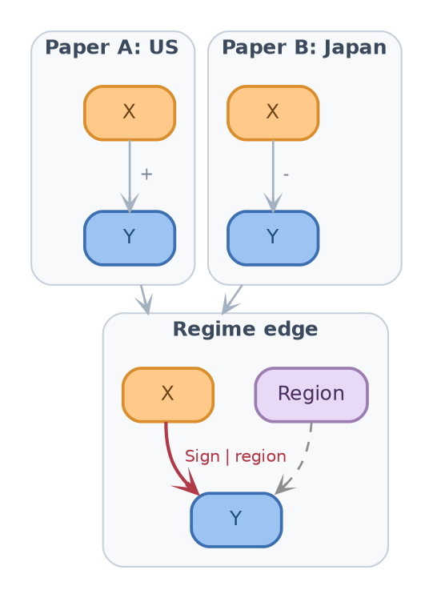
label=fig:conflict
caption=Two papers with opposite signs on X to Y merge into one regime edge whose sign depends on the region

::::
:::

* Merge DAGs Across Papers
// From: papers/Causal_Analysis_for_Finance/notes.md:150 '## Merge DAGs'
// From: papers/Causal_Analysis_for_Finance/notes.md:369 '- **Zhang et al. (2024)**: LACR, RAG over papers, the LLM extracts associations'

::: columns
:::: {.column width=55%}
- @Goal@: combine the per-paper DAGs into one **literature-level graph**
  - Canonical ids make the merge possible

- @Techniques@: vote, union, weighted average, condition over the edges

- @Intuition@: ensemble learning, where the "models" are papers

- @Example@: **LACR** takes a majority vote across documents, and builds the
  skeleton before it orients the edges (Zhang et al., 2024)

- @Remark@: a strong vote is not causal truth: publication bias can make
or   many papers repeat one error
::::
:::: {.column width=45%}

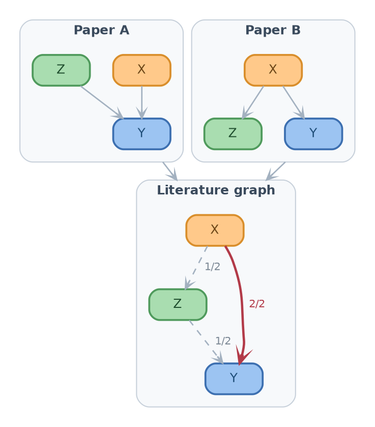
label=fig:merge-dags
caption=Two paper DAGs merge into a literature graph whose edge labels count the votes: the bold red edge has the support of both papers.

::::
:::

# Validating the Graph

* Reduce the DAG
// From: papers/Causal_Analysis_for_Finance/notes.md:154 '## Reduce DAG'

::: columns
:::: {.column width=58%}
- @Problem@: the merged DAG is large and potentially (partly) wrong
  - Not every edge is meaningful
  - Not every node is predictive or has high-quality data

- @Solution@: **DAG reduction**
  - Test if the data is consistent with each edge (e.g., conditional
    independence, usual causal battery of tests)
  - Drop the nodes with poor data or no predictive power
  - Propose missing nodes and edges from an LLM or a human

::::
:::: {.column width=42%}

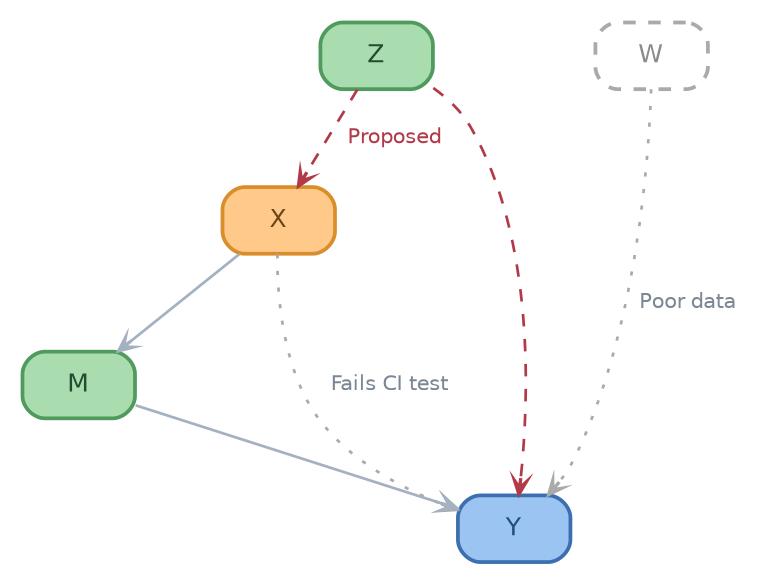
label=fig:reduce
caption=Reduction keeps the solid edges, drops the dotted gray node and edge, and adds the dashed red edges proposed by an LLM or a human.

::::
:::

* Identification of the Estimand
// From: papers/Causal_Analysis_for_Finance/notes.md:162 '- Causal validation'
// From: papers/Causal_Analysis_for_Finance/notes.md:321 '## Causal Inference Foundations'

::: columns
:::: {.column width=62%}
- @Definition@: an estimand is **identifiable** from a DAG if it is a
  function of the distribution of the observed variables
  - E.g., if $Z$ satisfies the backdoor criterion for $X \to Y$:
    $$
    \Pr(y | do(x)) = \sum_z \Pr(y | x, z) \Pr(z)
    $$

- @Key idea@: identification criteria are algorithmic, so the check can be
  automated (Huenermund and Bareinboim, 2025)
  - Tools: DoWhy (Sharma et al., 2020), pgmpy, y0

- @Remark@: identification is not proof of causality, since the assumptions
  of the DAG stay untested
::::
:::: {.column width=38%}

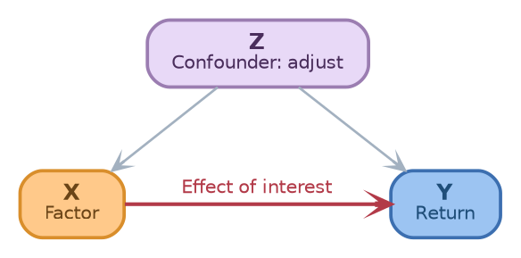
label=fig:backdoor
caption=Adjusting for the confounder Z (purple) blocks the backdoor path and identifies the effect of the factor X on the return Y.

::::
:::

* Testable Implications
// From: papers/Causal_Analysis_for_Finance/notes.md:168 '  - List the conditional independencies implied by the DAG, then test them'

- @Problem@: identification takes the DAG as given, but part of the DAG can
  still be checked against data

- @Key idea@: every missing edge is a claim that the data must satisfy
  - d-separation lists the conditional independencies that the DAG implies

```{=typst}
#styled-table(
  headers: ("Structure", "Graph", "Implied by the DAG", "Example"),
  rows: (
    ([Chain], [$X -> M -> Y$], [$X perp Y | M$], [A mediator carries the whole effect]),
    ([Fork], [$X <- Z -> Y$], [$X perp Y | Z$], [A confounder explains the whole association]),
    ([Collider], [$X -> C <- Y$], [$X perp Y$, dependent given $C$], [Do not control for $C$]),
  ),
  col-widths: (0.8fr, 1fr, 1.4fr, 2fr),
  width: 95%,
)
```

- @Techniques@: test each implied independence on the discovery split (e.g.,
  partial correlation)
  - Log each test in the ledger

- @Remark@: a failed test falsifies part of the theory, but a passed test does
  not prove it

* The Factor Mirage Diagnostic
// From: papers/Causal_Analysis_for_Finance/notes.md:164 '  - Compare the theory DAG with the empirical specification of the paper'
// From: papers/Causal_Analysis_for_Finance/notes.md:339 '- **Lopez de Prado and Zoonekynd (2026)**: "Correcting the Factor Mirage", a'

::: columns
:::: {.column width=60%}
// TODO(gp): Check the definition of "factor mirage" against the abstract of Lopez de Prado and Zoonekynd
- @Definition@: a **factor mirage** is a factor whose estimated effect comes
  from a misspecified regression, not from a causal effect
  - Confounder and collider bias are the usual causes (Lopez de Prado and
    Zoonekynd, 2025)

- @Solution@: compare the theory DAG with the regression of the paper
  - Flag **collider** or **mediator** controls
  - Flag **omitted confounders**

- @Example@: regress the return $Y$ on the factor $X$, controlling for $C$,
  where $X \to C \leftarrow Y$
  - Conditioning on $C$ opens the path $X \to C \leftarrow Y$
  - $X$ looks predictive even if it has no effect on $Y$
::::
:::: {.column width=40%}

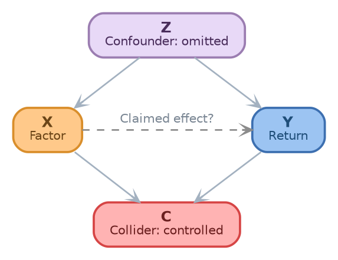
label=fig:mirage
caption=Two sources of a factor mirage: an omitted confounder Z (purple) and a controlled collider C (red) both create an association between X and Y.

::::
:::

* Proxy Targets and Bayesian Priors (Research idea)
// From: papers/Causal_Analysis_for_Finance/notes.md:177 '## Optimize Against Proxy'
// From: papers/Causal_Analysis_for_Finance/notes.md:183 '## Formalize Hypotheses'

- @Problem@: some targets are hard to model directly (e.g., prices)

- @Solution@: optimize against a **proxy**
  - E.g., use the model to predict supply and demand, instead of prices
  - Regularize to trade complexity against predictive power

- @Definition@: **formalize** the reduced DAG as a set of hypotheses with a
  **Bayesian prior** on each edge
  - Build the prior of each edge from its evidence: number of supporting
    papers, quality of the identification design, agreement on the sign
  - Fit the model, then estimate the uncertainty of each effect

// TODO(gp): Check the prior formula: self-made illustration, not in the notes
- @Example@: a prior on the coefficient $\beta_e$ of edge $e$
  $$
  \beta_e \sim \mathcal{N}(s_e \mu_e, \sigma_e^2)
  $$
  - $s_e \in \{-1, +1\}$ = sign on which the papers agree
  - $\sigma_e$ shrinks as the number of papers and the design quality grow

# From Graph to Verified Code

* Generate Code: Three Artifacts
// From: papers/Causal_Analysis_for_Finance/notes.md:194 '## Generate Code'

::: columns
:::: {.column width=58%}
- @Goal@: generate three artifacts from each Theory Spec
  1. **Simulator**: an SCM with known effects
  2. **Replication module**: the data construction plus the estimator of the
     paper
  3. **Causal estimator**: the identified estimate of the estimand

- @Intuition@: the simulator gives a ground truth
  - If an estimator cannot recover a known effect on simulated data, do not
    trust it on real data

- @Key idea@: boilerplate is a tested library that the LLM composes but does
  not rewrite
  - E.g., CRSP and Compustat merges, portfolio sorts, Newey-West

- @Remark@: generated code never depends silently on an `inferred` edge
::::
:::: {.column width=42%}

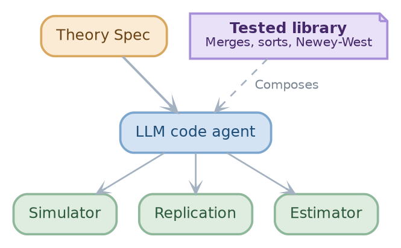
label=fig:codegen
caption=An LLM code agent (blue) composes a tested library (violet) to turn a Theory Spec (orange) into three artifacts (green).

::::
:::

* Verify Against the Source Paper
// From: papers/Causal_Analysis_for_Finance/notes.md:203 '## Verify Against Source Paper'

::: columns
:::: {.column width=55%}
- @Goal@: check that the generated code reproduces the paper
  - Run the code in a sandbox
  - Compare its output $\hat{\theta}$ with the tables of the paper

- @Solution@: route each mismatch back to the stage that caused it
  - Wrong data recipe
  - Missing confounder
  - Bug
  - ...

- @Applications@: this stage delivers the replication of papers
  - A possible solution to the replication crisis!

::::
:::: {.column width=45%}

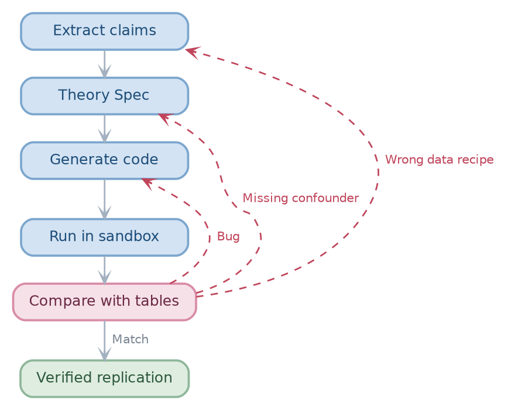
label=fig:verify
caption=Each mismatch with the tables of the paper (rose) is routed back, along a dashed red edge, to the stage that caused it.

::::
:::

* The Hypothesis Ledger
// From: papers/Causal_Analysis_for_Finance/notes.md:258 '## Hypothesis Ledger and Data Splits'

- @Problem@: A backtest that ignores the earlier tests overstates its significance
  - To deflate by the tested hypotheses, the pipeline needs a count of the hypothesis
  - The seven-step protocol of Lopez de Prado and Zoonekynd ends with a multiple
    testing adjustment
  - A new factor needs $t \ge 3.0$ (Harvey et al., 2016)

- @Solution 1@: two data splits, each with one use
  - _Discovery_: DAG reduction and proxy choice
  - _Validation_: backtesting, touched once, at the final gate (embargo)

::: columns
:::: {.column width=60%}

- @Solution 2@: the **hypothesis ledger** holds one record per every test
  - Edge tests in DAG reduction
  - Edges proposed by an LLM or by a human
  - Generalize the notion of "backtesting overfitting" to "research overfitting"

- Holy grail of theories like Minimum Description Length
  - Quantify each decisions in terms of bits of complexity
::::
:::: {.column width=40%}

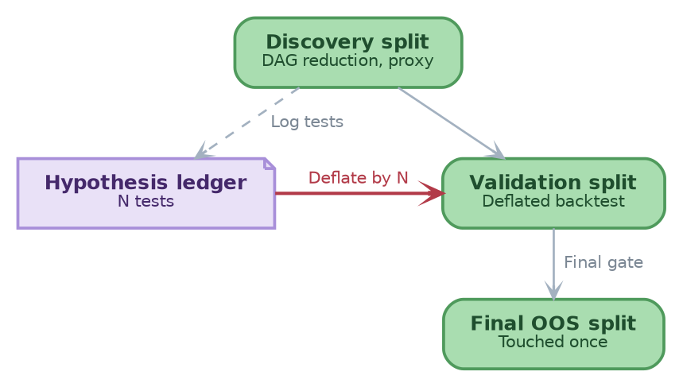
label=fig:ledger-splits
caption=Green data splits are used in order, and the violet ledger counts every test to deflate the backtest.

::::
:::

* Validation and Human Gates
// From: papers/Causal_Analysis_for_Finance/notes.md:213 '## Validation'
// From: papers/Causal_Analysis_for_Finance/notes.md:277 '## Human Review Gates and Metrics'

::: columns
:::: {.column width=60%}
- @Definition@: **human gate** is when a human sees an artifact of Theory Store and
  accepts / edits / rejects it

- @Algorithm@: Research
  1. Propose a formalized hypotheses (Theory Store)
  2. Researcher vote on the proposal
  3. Backtest on the validation split, deflated by the ledger
  4. Final gate: run on the final OOS split, untouched until now
::::
:::: {.column width=40%}

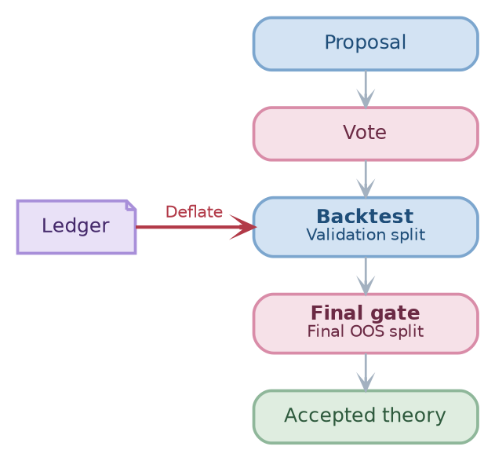
label=fig:validation
caption=A proposal passes a vote and a final gate (rose) around a backtest deflated by the ledger (violet).

::::
:::

# Evaluation and Related Work

* Pilot and Evaluation
// From: papers/Causal_Analysis_for_Finance/notes.md:289 '## Pilot and Evaluation'

- Possible first targets:
  - Microeconomic papers
  - Macroeconomic papers
  - ...

- Reproduce some paper end-to-end

- Reproduce some of the research we already have in production

- Detect and flag papers with factor mirage

* Many Open Research Questions
// From: papers/Causal_Analysis_for_Finance/notes.md:390 '# Open research questions'

- @Questions@:
  - How to represent concepts, e.g., with knowledge graphs?
  - How to handle equilibrium papers that do not fit a DAG?
  - What objective should the reduced DAG optimize?
    - E.g., out-of-sample fit, number of untestable assumptions, agreement with
      the literature-level graph
  - Who builds the gold graph of causal claims?
  - How to verify against tables that code generates and the source includes as
    external files?
  - How to extend the pipeline to macro nodes, time unrolling, and point-in-time macro
    data?
  - ...

- @Goal@: "Solve" finance
  - Enable machine (supervised by humans) to reason about economic / financial
    systems
  - Create and falsify automatically theories
  - Speed up and increase quality of quant research

* Related Work: Causality and Finance
// From: papers/Causal_Analysis_for_Finance/notes.md:321 '## Causal Inference Foundations'
// From: papers/Causal_Analysis_for_Finance/notes.md:335 '## Causality in Finance'

```{=typst}
#styled-table(
  headers: ("Work", "What it gives the Theory Store"),
  rows: (
    ("Pearl (2009)", "SCMs, do-calculus, backdoor and frontdoor identification: the formal base for the DAG and the estimand check"),
    ("Peters et al. (2017)", "A free and code-friendly treatment of causal models"),
    ("Imbens (2020)", "A bridge between DAGs and the potential outcomes that finance papers use"),
    ("Huenermund and Bareinboim (2025)", "Identification criteria are algorithmic, so the check can be automated"),
    ("Sharma and Kiciman (2020)", "DoWhy, the library for the identification and estimation steps"),
    ("Lopez de Prado (2023)", "Factor papers make associational claims, with no causal graph: the gap to fill"),
    ("Lopez de Prado et al. (2024, 2025)", "The correct specification needs the causal graph; confounder and collider bias give test cases"),
    ("Harvey et al. (2016), Hou et al. (2020), Jensen et al. (2023)", "Replication benchmarks: none tests the causal specification"),
    ("Chen and Zimmermann (2022)", "Code and data for 319 characteristics: ground truth for code generation"),
  ),
  col-widths: (1.5fr, 3fr),
  size: 0.65em,
  width: 100%,
)
```

* Related Work: LLMs, Text, and Code
// From: papers/Causal_Analysis_for_Finance/notes.md:355 '## Causal Structure From Text'
// From: papers/Causal_Analysis_for_Finance/notes.md:377 '## Paper-to-Code and LLM Quant Agents'

```{=typst}
#styled-table(
  headers: ("Work", "What it gives", "What it lacks"),
  rows: (
    ("FinCausal (Mariko et al., 2020)", "Cause and effect spans in finance text", "Builds no graph"),
    ("Kiciman et al. (2023)", "LLMs do well on causal reasoning tasks", "No finance papers"),
    ("Corr2Cause, Causal Parrots (2023)", "Failure modes of LLM causal inference", "Why inferred claims are flagged"),
    ("LACR (Zhang et al., 2024)", "RAG, majority vote, skeleton before orientation", "Reusable in Merge DAGs"),
    ("Garg and Fetzer (2025)", "Evidence-labeled claim graphs of economics papers", "No identification or estimation"),
    ("ReCITE (Saklad et al., 2025)", "Graph benchmark with SHD, precision, recall", "Few finance papers"),
    ("R&D-Agent-Quant (Li et al., 2025)", "Hypotheses, then code, then backtests", "Closest finance analogue"),
    ("FactorEngine (Lin et al., 2026)", "Financial reports to executable factors", "No causal graph"),
    ("Paper2Code, PaperBench (2025)", "Agents replicate ML papers, graded by rubric", "Target ML papers"),
    ("Nougat (Blecher et al., 2023)", "PDF to markup with equations", "A front end for PDF input"),
  ),
  col-widths: (1.7fr, 2fr, 1.3fr),
  size: 0.62em,
  width: 100%,
)
```
