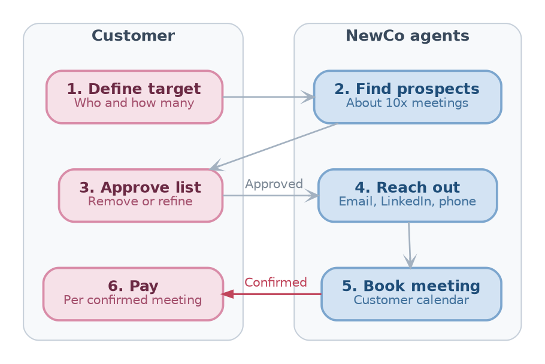
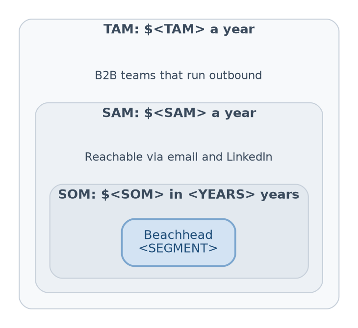
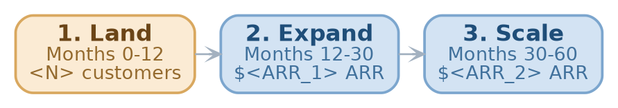

// type=UMD_slides
// course_title=NewCo: Investor Presentation
// lesson_title=\<ROUND\>: Founders and sales teams pay only for confirmed meetings, not for cold outreach
// Authors=GP, Samarth, Vedanshu
// logo=assets/images/NewCo_logo_placeholder.png
// slides_engine=typst
// TODO(gp): Replace NewCo with the final company name : NewCo is a working name
// TODO(gp): Replace the placeholder logo with the NewCo logo : downloaded from placehold.co
// TODO(gp): Provide <ROUND> and <ASK> : not in the input

* NewCo at a Glance

- **What**: AI agents that book qualified meetings on the customer's calendar

- **Who pays**: founders and B2B sales teams who need meetings with
  investors, customers, and partners

- **Model**: pay per confirmed meeting, in packs of 10, 50, or 100

- **Edge**: NewCo carries the cost of failed outreach and the risk to the
  sender's domain

// TODO(gp): Provide <MILESTONE> : not in the input
- **Raising**: \<ASK\> \<ROUND\> to reach \<MILESTONE\>

* Outbound Burns Time, Money, and Domains

// TODO(gp): Check hit rate below 1% : stated in the input without a source
- **Under 1% hit rate**: hundreds of cold emails yield a handful of replies

// TODO(gp): Provide <HOURS> : not in the input
- **\<HOURS\> hours a week**: finding emails and decision makers, writing,
  and following up

- **Account risk**: spam flags hurt the domain, Google pauses accounts for
  days, and LinkedIn restricts profiles

- **Specialist work**: domain warm-up, inbox rotation, bounce control, and
  spam filters

// TODO(gp): Provide <N> and <M> from one real customer interview : not in the input
- **Typical case**: a founder emails \<N\> investors, books \<M\> meetings,
  and puts the company domain at risk

* Pay Only for Meetings That Happen

- **Today**: teams stitch together Sales Navigator, PhantomBuster, email
  finders, and mail merge, then pay for every attempt

- **With NewCo**: the customer states who to meet and how many meetings,
  and NewCo books them on the customer's calendar

- **Pay on outcome**: only confirmed meetings are billed, never emails sent
  or leads found

- **Clean accounts**: all outreach runs on NewCo infrastructure, so customer
  domains stay safe

- **Known cost**: the price per meeting is fixed before the campaign starts

* From Target Profile to Booked Meeting

::: columns
:::: {.column width=60%}
- **Customer in control**: approves every prospect before any outreach
  - E.g., for 50 meetings with Heads of Growth at Series A to C US fintech
    startups, NewCo lists about 500 prospects to approve

- **Agents do the work**: search LinkedIn, PitchBook, and Crunchbase, then
  email, message, and call

- **Calendar ready**: NewCo handles time zones and confirms attendance

- **Warm handoff**: the customer joins only once the meeting is confirmed
::::
:::: {.column width=40%}


// label=fig:product-flow
// caption=The six steps from target profile to paid meeting, with customer steps in rose and NewCo agent steps in blue.

::::
:::

* Why Now: Agents Got Cheap, Email Got Strict

// TODO(gp): Provide <MINUTES> : not in the input
- **Agents can do the research**: profile each prospect and write a custom
  email per company, work that takes a sales rep \<MINUTES\> minutes

// TODO(gp): Check the Google rule summary against the official page : found by a web search, the page title is not verified
- **Email rules got strict**: since February 2024, Gmail requires senders of
  5,000+ emails a day to authenticate and stay under a 0.3% spam rate
  (Google, 2024)

// TODO(gp): Provide <X>, <Y>, <YEAR> with a cited source : not in the input
- **Model costs keep falling**: one custom email costs \$\<X\> in LLM calls,
  down from \$\<Y\> in \<YEAR\>

// TODO(gp): Check prices and speeds : from team tests in the I-Corps notes, the test date is not stated
- **Contact data is a commodity**: \$0.016 to \$0.03 per email, found in 5
  to 30 seconds (team tests of Hunter.io, Dropcontact, Snov.io)

* A \<TAM\> Market, Sized Bottom-Up

::: columns
:::: {.column width=60%}
// TODO(gp): Provide <TAM>, <N>, <REGION>, <M>, <P> with a cited source for each : not in the input
- **TAM \$\<TAM\> a year**: \<N\> B2B teams in \<REGION\> that run outbound
  $\times$ \<M\> meetings a year $\times$ \$\<P\> per meeting

// TODO(gp): Provide <SAM> and <N_REACH> : not in the input
- **SAM \$\<SAM\> a year**: \<N_REACH\> teams reachable today through email
  and LinkedIn

// TODO(gp): Provide <SOM>, <YEARS>, <SHARE> : not in the input
- **SOM \$\<SOM\> in \<YEARS\> years**: \<SHARE\>% of SAM, starting from the
  beachhead

// TODO(gp): Provide a top-down cross-check from an analyst report : not in the input
- **Cross-check**: \<REPORT\> sizes \<CATEGORY\> at \$\<USD\> in \<YEAR\>
::::
:::: {.column width=40%}


// label=fig:market-size
// caption=Nested TAM, SAM, and SOM, with the beachhead segment of the SOM in blue.

::::
:::

* Land \<SEGMENT\>, Then Expand

::: columns
:::: {.column width=60%}
// TODO(gp): Provide <SEGMENT>, <BUYER_TITLE>, <CHANNEL>, <MOTION> : not in the input, candidates are founders doing VC outreach or customer discovery
- **Beachhead**: \<SEGMENT\>, bought by the \<BUYER_TITLE\>, sold through
  \<CHANNEL\> with \<MOTION\>

// TODO(gp): Provide the time windows, channels, and milestones : not in the input
- **Months 0-12**: win \<SEGMENT\>, reach \<N\> paying customers

- **Months 12-30**: expand to \<ADJACENT_SEGMENT\> via \<CHANNEL_2\>, reach
  \$\<ARR_1\> ARR

- **Months 30-60**: scale through \<NEW_CHANNEL\>, reach \$\<ARR_2\> ARR

// TODO(gp): Provide <CAC> and <MONTHS> : not in the input
- **Target CAC**: \$\<CAC\> per customer, paid back in \<MONTHS\> months
::::
:::: {.column width=40%}


// label=fig:gtm-phases
// caption=The three go-to-market phases from the beachhead to scale, with the beachhead in orange.

::::
:::

* Everyone Else Bills for Effort

// TODO(gp): Check pricing and domain risk of appointment-setting agencies : not in the input, some may already charge per meeting
```{=typst}
#styled-table(
  headers: ("Option", "Customer pays for", "Finds prospects", "Who takes domain risk", "Books meeting"),
  rows: (
    ("Manual outreach", "Staff time", "By hand", "Customer", "By hand"),
    ("Hunter.io, Dropcontact, Snov.io", "Each email found", "Emails only", "Customer", "No"),
    ("Sales Navigator, PhantomBuster", "Seats, credits", "Yes", "Customer", "No"),
    ("Appointment-setting agencies", "<MODEL>", "Yes", "<RISK>", "Yes"),
    ("NewCo", "Confirmed meeting", "AI agents", "NewCo", "Yes"),
  ),
  col-widths: (1.8fr, 1.2fr, 1fr, 1.2fr, 1fr),
  bold-first-col: true,
)
```

// TODO(gp): Provide the moat that stops agencies and tools from copying the pricing : not in the input
- **NewCo's edge**: paid only on outcome, while taking on the outreach work
  and the domain risk

* Pricing: \$\<PRICE\> per Confirmed Meeting

// TODO(gp): Provide <PRICE> and <REORDERS> : not in the input
- **Pricing**: \$\<PRICE\> per confirmed meeting, sold in packs of 10, 50,
  or 100

- **Repeat buying**: \<REORDERS\> packs per customer a year

// TODO(gp): Check prospects per meeting : the product doc plans about 10 (a 10% meeting rate), but the problem slide states a hit rate below 1%
- **Cost driver**: cost per meeting = cost per prospect $\times$ prospects
  contacted per meeting, planned at about 10

// TODO(gp): Provide cost per meeting, gross margin, LTV, and CAC : not in the input
- **Unit economics**
  ```{=typst}
  #styled-table(
    headers: ("Price per meeting", "Cost per meeting", "Gross margin", "LTV / CAC"),
    rows: (
      ("$<PRICE>", "$<COST>", "<GM>%", "<RATIO>"),
    ),
    bold-first-col: false,
  )
  ```

* Pipeline Built and Running Since 2024

// TODO(gp): Provide meetings booked, paying customers, and letters of intent : not in the input
- **Commercial**: \<MEETINGS\> meetings booked, \<CUSTOMERS\> paying
  customers, \<LOIS\> letters of intent as of \<MONTH_YEAR\>

// TODO(gp): Check the start date : the meeting notes discuss lead automation on 2024-06-03, so the pipeline may be older
- **Live since June 2024**: in-house pipeline from Sales Navigator search to
  a custom email per company

- **5 data vendors benchmarked**: PhantomBuster, Hunter.io, Dropcontact,
  Snov.io, and Proxycurl on accuracy, speed, and price

// TODO(gp): Check which target lists are complete : the notes show them as tasks in progress
- **3 verticals targeted**: fintech, sports betting, and ERCOT energy

// TODO(gp): Check I-Corps participation and provide <INTERVIEWS> : only a doc title mentions I-Corps
- **NSF I-Corps**: \<INTERVIEWS\> customer discovery interviews

* Team Behind the Pipeline

// TODO(gp): Check that GP Saggese is a founder and provide <ROLE> : the input names GP as CTO of Causify AI, not of NewCo
- **GP Saggese**, \<ROLE\>: CTO of Causify AI, teaches AI and machine
  learning at the University of Maryland

// TODO(gp): Provide <ROLE> and <CREDENTIAL> : the Project doc lists the name and email only
- **Vedanshu Joshi**, \<ROLE\>: \<CREDENTIAL\>

// TODO(gp): Provide <ROLE> and <CREDENTIAL> : the Project doc lists the name and email only
- **Samarth KaPatel**, \<ROLE\>: \<CREDENTIAL\>

* Raising \<ASK\> for \<RUNWAY\> Months

::: columns
:::: {.column width=60%}
// TODO(gp): Provide <ASK>, <ROUND>, <RUNWAY>, and the milestone values : not in the input
- **The round**: \<ASK\> \<ROUND\>, \<RUNWAY\> months of runway

- **Milestones**
  1. \<CUSTOMERS\> paying customers, \<MEETINGS\> meetings a month
  2. Cost per meeting under \$\<COST\>, gross margin over \<GM\>%
  3. \$\<ARR\> ARR, ready for the next round
::::
:::: {.column width=40%}
// TODO(gp): Provide the use of funds split : not in the input, the four parts must sum to 100%
- **Use of funds**
  ```{=typst}
  #styled-table(
    headers: ("Area", "Share"),
    rows: (
      ("Product", "<P1>%"),
      ("Infrastructure", "<P2>%"),
      ("Sales", "<P3>%"),
      ("Operations", "<P4>%"),
    ),
    col-widths: (1.5fr, 1fr),
    bold-first-col: true,
  )
  ```
::::
:::

* Why Invest in NewCo

- **Common, costly problem**: every founder and sales team needs meetings,
  and cold outreach hits under 1%

- **Outcome pricing**: customers pay only for confirmed meetings

- **Right timing**: agents make research cheap while email rules punish
  careless senders

- **Working pipeline**: built and in use since 2024

- **The ask**: \<ASK\> to reach \$\<ARR\> ARR in \<RUNWAY\> months

* Sources

- **Google**: _"Email sender guidelines FAQ"_, Google Workspace Admin Help
  (2024), https://support.google.com/a/answer/14229414
